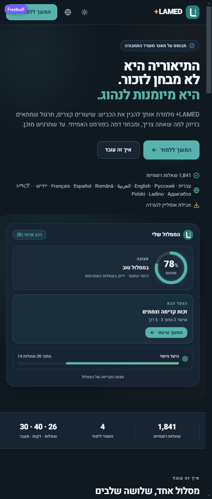
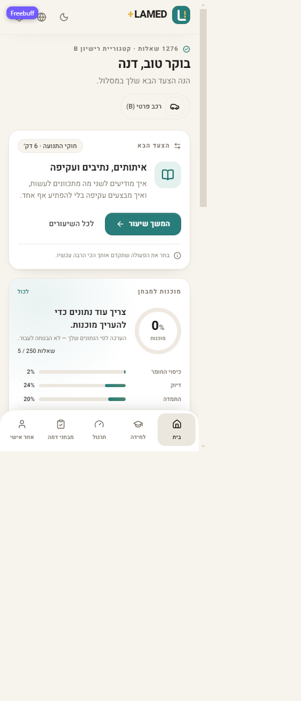
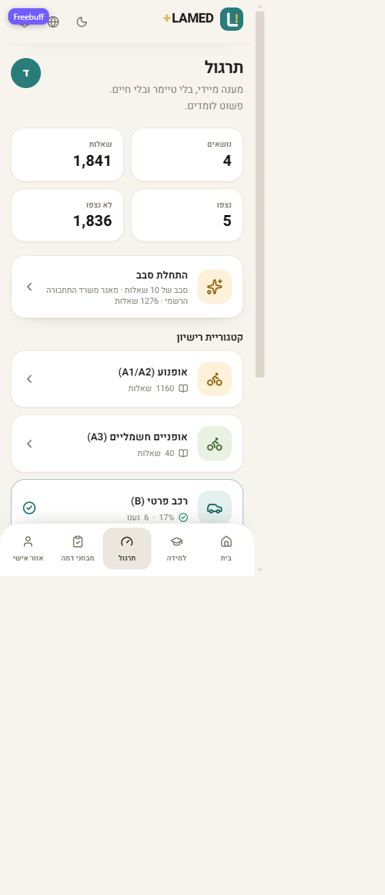
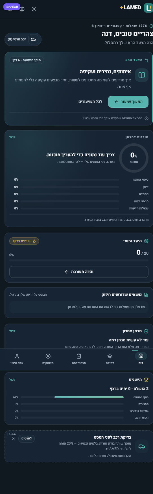

# LAMED+ — Israeli driving theory, done properly

**לומדים נכון. עוברים בטוח.**

LAMED+ is an offline-first learning product for the Israeli driving theory exam. It pairs the official Ministry of Transport question bank with short lessons, adaptive practice, a real-format mock exam and an explainable readiness score, with an eleven-language interface and a Hebrew-first RTL design.

The visual identity is **LAMED+**: Cloud White surfaces, Deep Navy ink, Road Teal as the primary brand colour and Warm Amber for progress and milestones, with a Night dark theme.

## Screenshots

| Landing | Home |
| --- | --- |
|  |  |

| Practice | Progress |
| --- | --- |
|  |  |

## What it does

- **Learn** with short structured lessons across traffic law, road signs, road safety and knowing your vehicle, then check understanding against official questions. Every lesson is written in Hebrew and translated into English, Russian, Arabic, French and Spanish; the remaining interface languages read the Hebrew lessons.
- **Practice** in short 10-question rounds with immediate feedback, subject filters and no timer. Rounds are adaptive: weak and unseen topics appear more often. After a mistake, core questions show an authored explanation (`data/explanations.json`); the rest link to the authored lesson point that explains the idea.
- **Review** mistakes with spaced repetition and a mixed queue of due and new questions.
- **Mock exam** in the real format: **30 questions, 40 minutes, 26 correct to pass** for every licence class. Drafts autosave, so an interrupted exam resumes where it stopped, and results include a per-topic breakdown with a link to the weakest topic, plus the authored explanation for every mistake.
- **A3 electric bicycle** exam: 40 complete official questions in the bank and a dedicated 30-question, 40-minute, 26-to-pass route in Hebrew, English, Arabic, French and Spanish.
- **Games**: True/False Blitz and Sign Sprint, both generated from official questions.
- **Progress**: daily goal, streak, XP, levels, achievements, mastery per topic and exam history — all stored locally.
- Eleven-language interface: Hebrew, English, Russian, Arabic, French, Spanish, Romanian, Yiddish, Amharic, Polish and Ladino, with full RTL support for Hebrew, Arabic and Yiddish. Adyghe has a catalog entry that still mirrors Hebrew, so it is not offered or marketed as a translated interface.
- Official question coverage: Hebrew, English, Russian and Arabic for B, A, C, C1, BUS and TRACTOR; A3 also in French and Spanish. Missing translations fall back to Hebrew, then English, with a visible notice instead of silently mixing languages.
- Accessibility controls: 100–140% text scaling, high contrast, reduced motion, underlined links, comfortable reading and read-aloud, all persisted locally.
- Light, dark and system themes. Installable PWA; the app shell works offline immediately, while official questions and images are cached per topic and per image as you use them.

## Accessibility

Accessibility is part of the product, not a statement page. Settings includes text scaling (100%, 112.5%, 125%, 140%), high contrast, reduced motion, underlined links, comfortable reading spacing and read-aloud for questions and lessons. Preferences persist on the device, focus is always visible, touch targets are enlarged, and decorative motion stops for `prefers-reduced-motion` and the in-app reduced-motion setting.

The target is WCAG 2.2 AA. Official content language coverage is still uneven: B, A, C, C1, BUS and TRACTOR have he/en/ru/ar, while A3 has he/en/ar/fr/es. The app shows an English fallback notice when a requested translation does not exist.

## Official data

Questions and images come from the Israeli Ministry of Transport and Road Safety open-data bank published on [data.gov.il](https://data.gov.il). The importer merges duplicate question numbers across licence classes and maps official class tags to app categories:

| Official tag | App category |
| --- | --- |
| `B` / `В` | `B` |
| `A` | `A` |
| A3 (separate official feed) | `A3` |
| `C1` | `C1` |
| `C` | `C` |
| `D` | `BUS` |
| `1` | `TRACTOR` |

Current import: **1,841 playable questions** across 11 bank files (920 traffic law, 414 safety, 391 signs, 116 vehicle) and **599 image questions across 444 unique image files**, with zero missing image files. The bank is stored under `data/bank/*.json`; each question lists every category it belongs to, so there is no per-category duplication. A3 adds 40 complete official questions in Hebrew, English, Arabic, French and Spanish.

The bank is split by topic at build time. A practice round loads only the files it needs (one topic when a filter is active), so a 10-question round never downloads all 1,841 questions. Lesson content lives in `src/lib/content/curriculum.ts` (Hebrew, the authored source) with per-language files `curriculum.en.ts`, `.ru.ts`, `.ar.ts`, `.fr.ts` and `.es.ts`, plus generated `curriculum.{ro,pl,yi,am,lad}.json`; a structural test keeps the translated versions in sync and Adyghe falls back to Hebrew.

See [`data/README.md`](data/README.md) for the data layout, schema and import details.

## Stack

- React 19 + TypeScript + Vite
- Tailwind CSS v4 with CSS custom-property design tokens
- React Router (hash routing, so the app works from any static host)
- IndexedDB (`idb`) for progress; `localStorage` for theme and the exam draft
- `vite-plugin-pwa` / Workbox for offline precaching
- Vitest for unit tests, Playwright for E2E
- Fonts: Heebo (Hebrew body and display), Inter (Latin/Cyrillic), Noto Sans Arabic (Arabic)
- Lucide icons through a single icon wrapper, with semantic design tokens in `src/index.css`

## Development

```bash
npm install
npm run dev          # dev server
npm run build        # validate data, typecheck and build
npm run preview      # preview the production build
npm run check        # validate data + lint + typecheck + tests
npm test             # unit tests
npm run test:e2e     # Playwright
npm run audit:offline # needs `vite preview --port 4176` in another shell
npm run validate:data
npm run generate:icons
```

The importer is run separately and is not part of the normal build:

```bash
node scripts/import-official.mjs            # use cached XML, download images
node scripts/import-official.mjs --refresh  # re-download XML and images
node scripts/import-official.mjs --no-images
```

### Optional configuration

| Variable | Effect |
| --- | --- |
| `VITE_SUPPORT_EMAIL` | Where a question report is sent. Without it the app copies the report to the clipboard instead. |
| `VITE_SUPABASE_URL` | Supabase project URL. Enables the optional account, cross-device sync and opt-in analytics. There is no paid tier in the product; ads are the only revenue. |
| `VITE_SUPABASE_ANON_KEY` | Public anon key of that project. Row level security is defined in `supabase/schema.sql`. |

A build with no environment variables is still a complete offline learner: no account,
no sync, no ads revenue, no measurement. The cloud layer activates only when both
Supabase values are present, and analytics stay off until the learner allows them.

Cloud setup: create a Supabase project, run `supabase/schema.sql`, then set the two
variables. Sign-in is a one-time email link; the account is optional and guest progress
is never uploaded without signing in. The schema also installs `delete_my_account()`, a
security-definer function the settings screen calls for self-service account deletion.

## Project layout

```
data/                 official bank, categories, topics and i18n catalogs
public/               static assets, official images, icons, robots.txt
scripts/              official importer, data validator, icon generator
src/
  components/         shared UI (icons, logo, question renderer, layout)
  lib/content/        bank loading, categories, topics, lesson curriculum and
                      its five translations, asset URLs
  lib/a11y/           accessibility preferences, text scaling and read-aloud
  lib/i18n/           language detection and catalog loading
  lib/progress/       progress state, XP, streaks, SRS, achievements
  lib/store/          IndexedDB access
  pages/              Landing, Onboarding, Home, Learn, Subject, Lesson, Practice,
                      Review, Exams, Exam, Games, Signs, Stats, Achievements,
                      Profile, Settings
  lib/content/        lesson curriculum, topics, categories, official bank
  index.css           LAMED+ tokens, themes, type scale, components
```

## License

The source code is released under the [MIT License](LICENSE). Official questions, images and metadata under `data/` and `public/assets/official/` remain the property of the Israeli Ministry of Transport and Road Safety and are used under the terms of their open-data publication on [data.gov.il](https://data.gov.il); the MIT license does not cover that content.

## Disclaimer

LAMED+ is an independent study aid. It is not affiliated with the Israeli Ministry of Transport or the licensing authority. Official questions and images remain the property of the Ministry and are used under the terms of their open-data publication.
